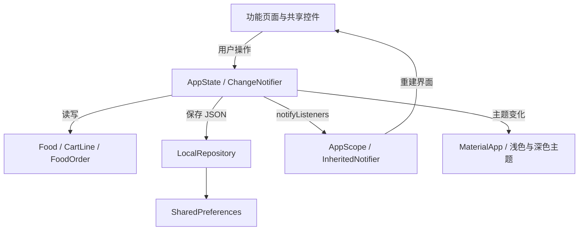

# 项目结构与架构说明

## 1. 设计目标

用较少的依赖实现可运行、可验证的 Flutter 餐饮点单应用。以功能组织页面，统一主题和常用控件，业务状态集中管理，本地存储独立封装。当前版本是离线交互演示，便于继续接入服务端。

## 2. 目录结构

```text
Chief'sFood/
├── lib/
│   ├── main.dart                       # 初始化 Flutter、方向与本地存储
│   ├── app.dart                        # MaterialApp、37 个路由、启动页
│   ├── core/
│   │   ├── app_state.dart              # 购物车、收藏、订单、主题、资料
│   │   └── theme.dart                  # 浅色／深色主题及设计参数
│   ├── data/
│   │   ├── models.dart                 # Food、CartLine、FoodOrder、金额格式
│   │   └── local_repository.dart       # SharedPreferences JSON 读写
│   ├── shared/
│   │   └── widgets.dart                # 页面骨架、按钮、卡片、表单等
│   └── features/
│       ├── auth/auth_pages.dart        # 引导、账户、验证码、地址、成功页
│       ├── discover/discover_pages.dart # 首页、菜单、详情、搜索、筛选
│       ├── orders/order_pages.dart     # 购物车、结账、支付、跟踪、评价
│       └── profile/profile_pages.dart  # 资料、设置、安全、权限、模拟卡
├── assets/
│   ├── images/                         # 9 张 Pixso 原始素材
│   └── fonts/                          # Poppins 三种字重及 OFL 许可
├── android/                            # Android 原生壳与品牌启动图标
├── ios/                                # iOS 原生壳，需 macOS 验证
├── web/                                # Flutter Web 入口
├── test/app_test.dart                  # 77 项逻辑与组件测试
├── integration_test/app_test.dart      # 模拟器端点单流程与截图
├── test_driver/integration_test.dart   # 截图落盘与测试结果摘要
├── docs/
│   ├── ARCHITECTURE.md                 # 本文
│   ├── DESIGN_SOURCE.md                # 原稿节点、素材与还原取舍
│   ├── SCREENSHOTS.md                  # 全部页面的截图索引
│   ├── VALIDATION.md                   # 验证记录与复现方法
│   ├── reference/                     # 17 张 Pixso 参考图
│   └── screenshots/                   # App 的浅色／深色运行截图
└── README.md                           # 总览、主要界面、启动说明
```

## 3. 分层与数据流



| 层 | 职责 | 边界 |
| --- | --- | --- |
| `features` | 展示与页面内交互、校验、导航 | 不直接操作 SharedPreferences |
| `shared` | 跨页面的视觉和交互控件 | 不包含独立的业务数据副本 |
| `core/AppState` | 跨页面状态、购物车计算、下单、收藏 | 存储通过 repository 调用 |
| `data/models` | 小型数据对象与整数金额 | 不依赖页面导航 |
| `data/LocalRepository` | JSON 与本地键值存储 | 不包含 UI 或路由 |

选用 Flutter 自带的 `ChangeNotifier`、`InheritedNotifier` 和 `Navigator`。运行时第三方依赖只有 `shared_preferences`，避免为当前规模引入额外的状态管理、路由或网络库。

## 4. 关键实现

### 金额与购物车

- 金额以整数美分保存，例如 `1256` 表示 `$12.56`，仅在展示时除以 100。
- 同餐品、同配料加入时合并数量；不同配料形成独立行。
- 单行数量限制为 1–99；减至 0 删除该行。
- 总件数、行小计、总金额均从购物车实时计算。
- `CHIEF10` 折扣为小计的 10%，按美分取整；空购物车不会创建订单。
- 下单时保存订单编号、总额和总件数，再清空购物车，避免历史金额随购物车变化。

### 数据保存

数据保存在 `chiefs_food_v1` 这个 JSON 键内：

| 数据 | 保存范围 |
| --- | --- |
| 主题、首次使用标记 | 跨启动保存 |
| 姓名、邮箱、电话、配送地址 | 跨启动保存 |
| 收藏、购物车行、订单摘要与收货状态 | 跨启动保存 |
| 搜索、筛选、当前餐品、折扣码、评分输入、可选预约日期 | 当前操作会话或页面 |
| 密码、真实银行卡 | 不保存 |

JSON 格式损坏时 repository 返回空数据；不认识的餐品或无效数量行会忽略。保存失败时在页面显示重试提示。SharedPreferences 适合本演示的小量数据；生产账户凭据和大规模订单应采用服务端及合适的本地数据库。

### 导航与主题

37 个页面路由统一定义在 `app.dart`。四个底部入口切换时清理原入口栈；详情、表单等次级页面保留正常返回。完成下单后清理结账栈，返回操作不会重复提交旧购物车。

浅色和深色共用同一组组件，主题切换不丢失购物车和资料。页面主体按内容滚动，主操作按钮通过 `PageFrame` 固定在底部；首页同时保留购买按钮和四个导航入口。Web 在较宽窗口下将主体限制到 600 逻辑像素。

### 可复用控件与代码精简

- `PageFrame`：标题、返回、通知、搜索、滚动、错误提示和底部区域。
- `PrimaryButton`、`Surface`、`SectionTitle`：统一按钮、卡片、标题。
- `LabeledField`：统一表单标签、输入框及校验入口。
- `FoodCard`、`FoodImage`：统一餐品展示。
- `QuantityControl`、`ChoicePills`：复用数量与选项交互。
- 登录／注册／忘记密码／重置密码共用 `AuthPage`。
- 下单成功／反馈成功／重置成功共用 `SuccessPage`。
- 购物车／我的订单／历史订单共用 `CartPage`。
- 三步引导复用 `OnboardingPage`，浅色／深色不复制页面代码。

已移除默认计数器页面、默认计数器测试和未使用的业务字段；资源为实际使用的素材，字体和图片均无需运行时下载。

## 5. 主流程

```text
启动 → 三步引导 → 登录／注册／直接体验 → 设置配送地址 → 首页
首页／菜单 → 餐品详情 → 数量与配料 → 加入购物车
购物车 → 折扣码 → 配送信息 → 模拟支付 → 确认订单
确认订单 → 模拟配送 → 标记收货 → 满意度 → 评分 → 感谢页
个人中心 → 资料／收藏／模拟支付方式／安全／权限／主题设置
```

账户流程验证输入格式，验证码固定为 `1234`。本地演示没有服务端账户，因此不会验证真实密码，也不发送邮件或短信。

## 6. 后续服务端接入位置

| 需求 | 建议修改位置 |
| --- | --- |
| 获取真实餐品和价格 | 将 `models.dart` 的静态目录替换为餐品 repository |
| 登录与验证码 | 在 `AuthPage`、`VerifyPage` 操作入口调用身份服务 |
| 支付 | `PaymentPage`，使用支付方 SDK 和服务端订单状态 |
| 地图与配送 | 替换 `DeliveryMapPainter`，订阅实际配送状态 |
| 订单详情 | 扩充 `FoodOrder` 保存餐品快照、配送地址、时间和状态枚举 |
| 评价上传 | `RatePage` 的提交回调接入评价接口 |

当前历史订单是总额、件数和收货状态的本地摘要；跟踪入口展示最新演示订单。评价展示提交结果，不向服务端提交或长期保存评论；可选预约日期用于界面演示，不实际安排配送。
